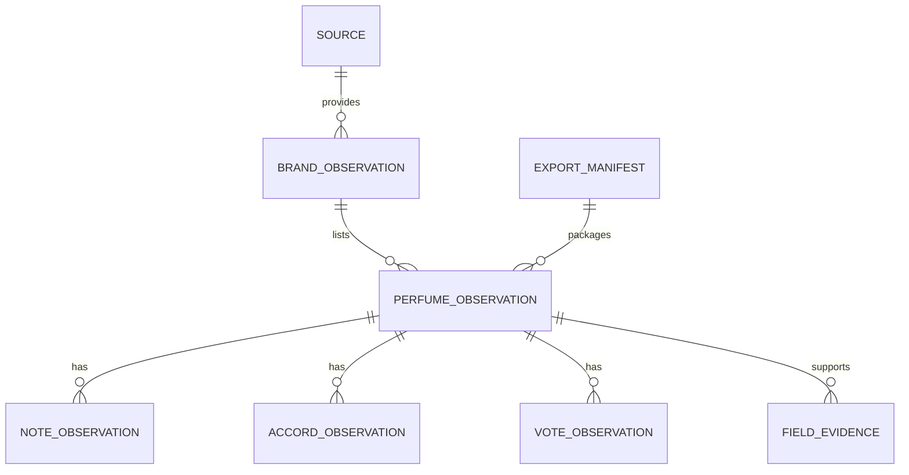

# Perfume data domain, normalization and parent handoff
Screenshots supplied by owner identify desired information sections. Fictional fixtures used to build/test. Fragrantica is not approved for live automation or restricted reuse; no source-specific recipe/selector here. A public webpage or source code scraper is not permission. All fields are conditional on an allowed source's actual content and rights.

## Domain relationship map

Source keys identify source observations, not parent canonical perfume IDs. Multiple sources, variants, time observations and conflicting claims allowed. No assumption notes are chemical ingredients. Rating/popularity separate from similarity. Never convert displayed vote bars to exact counts unless explicitly shown.

## Field dictionary
| Entity | Field | Type / meaning | Validation / missing |
|---|---|---|---|
| brand | source_brand_id | stable source ID | required or documented URL-derived key |
| brand | name | declared brand name | required, preserve raw |
| brand | aliases | array of declared aliases | optional, not inferred |
| brand | origin_country | declared origin | ISO mapping only if unambiguous |
| brand | brand_url | permitted reference URL | valid origin, sanitized |
| brand | logo_ref | image URL or owned asset ref | rights required for retention/reuse |
| brand | displayed_product_count | raw + number + approximate | observation not guaranteed total |
| perfume | source_perfume_id | source ID | required, stable key |
| perfume | source_brand_id | source relationship | required, orphan quarantine |
| perfume | name | declared product name | required, preserve original |
| perfume | detail_url | reference URL | approved origin and scheme |
| perfume | release_year | integer/year precision | optional, no inferred year |
| perfume | concentration | declared EDT/EDP/etc or raw | optional, normalize only clear value |
| perfume | target_audience | raw and normalized label | optional; not biological fact |
| perfume | perfumers | array of declared names | optional |
| perfume | family | declared fragrance family | optional, separate from accords |
| perfume | description_facts | licensed factual structured fields | optional, no bulk copied prose |
| perfume | image_ref | reference only by default | rights check for asset use |
| accord | label | raw/normalized | required |
| accord | rank | integer ordinal | preserve displayed order |
| accord | displayed_value | raw + numeric/unit if shown | null if unavailable |
| accord | visual_relative_width | measured relative display ratio | optional and explicitly not vote percent |
| rating | score | number | scale required, within scale |
| rating | scale_max | positive number | no assumption always 5 |
| rating | vote_count | raw + numeric + approximate | nonnegative, timestamp |
| rating | review_count | raw + numeric + approximate | distinct from votes |
| sentiment | label | declared rating bucket | raw/normalized |
| sentiment | count | raw + numeric + approximate | preserve displayed abbreviation |
| wear | category | season/day/night/other declared | normalized only clear label |
| wear | count | raw + numeric + approximate | no objective recommendation |
| note | layer | top/middle/base/unknown | declared, preserve unknown |
| note | label | note name | required |
| note | ordinal | displayed order | optional, not chemical weight |
| note | note_ref | source reference URL | optional, grant |
| note | image_ref | image URL ref | rights separate |
| performance | metric | longevity/sillage/etc | only declared metric |
| performance | value | raw + value/unit/scale | optional, no inferred duration |
| evidence | field_path | e.g. pyramid.top[0].label | required for observed value |
| evidence | source_url | sanitized URL | rights allowed |
| evidence | observed_at | UTC timestamp | required |
| evidence | rule_revision | recipe revision + selector reference | required |
| evidence | source_grant | grant ID/revision | required |
| evidence | raw_value | allowed source value | omit if rights prohibit |
| evidence | status/reason | observed/missing/ambiguous/invalid/truncated | required |
| evidence | confidence | extraction confidence, not factual certainty | optional, explain semantics |

## Extraction stages (generic, fixture-first)
Stage A: list of brands from an owned/approved catalogue -> source brand key, name, declared count and approved detail reference. Preview exact selected group; validate unique keys.
Stage B: approved brand catalogue -> list of perfume observations linked by source_brand_id. Pagination bounded; counts may not match displayed total; discrepancy reported.
Stage C: approved perfume detail -> independent hero object, accords array, rating/sentiment, wear, pyramid sections, optional performance. Validate required name/brand/key and nested field cardinality. Missing section is null/missing or empty-observed with evidence.
Stage D: normalize observations, map known aliases in candidate layer, compare duplicates/conflicts, quarantine unresolved entries. No automatic canonical promotion.
Stage E: create reviewed export manifest, run parent adapter dry-run against accepted parent schema contract, owner separately authorizes import. No parent DB connection in Tk-Web-Scraper.
A source-specific live adapter can only be planned/implemented after source grant and separate decision. Generic fixtures use independently authored DOM, fictional names and values; no raw capture of prohibited site.

## Normalization rules
- Trim/collapse whitespace under documented transform; preserve raw case/name and Unicode, do not strip meaningful punctuation or transliterate automatically.
- Brand/name/concentration/version/year are separate attributes. Do not merge flankers solely on similar names; keep candidate duplicates for human review.
- Normalize note aliases only against reviewed dictionary; store original label and alias mapping version. Unknown label retained; not automatically guessed.
- Raw displayed abbreviated count e.g. 2.3k -> approximate 2300 only with explicit locale transform; exact count unknown. Rating scale and observed time separate. Do not sum rounded counts and claim exact total.
- Accords order and measured visual widths are observations; no fabricated percent or weighting. Wear votes are community observations, not objective use suitability.
- Duplicate same source key + same observation hash may be collapsed in view while preserving provenance; different value/time -> distinct observation. Cross-source matches proposals only.
- Missing required values -> quarantine; optional missing values -> reason. Contradictory evidence remains distinct. No AI fills missing facts.
- Asset downloads only if grant covers download, storage, reuse; preserve attribution/license, MIME, size, hash, source. Reference URL not equivalent to image rights.

## Export manifest and files
Proposed directory local output/{opaqueExportId}; path chosen internally, not user/model supplied. Atomic write; manifest generated last after hashes. No raw private page capture.
| File | Contents |
|---|---|
| manifest.json | contractVersion, exportId, createdAt, job IDs, recipe hashes, source grant refs, counts, filenames, SHA-256, status, rights limitations |
| brands.json | brand observations |
| perfumes.json | perfume observations with source relationships |
| perfume_notes.json | layer, label, ordinal, source perfume key, evidence ref |
| perfume_accords.json | label, rank, observed value, evidence ref |
| observations.json | ratings, wear, performance, timestamp |
| evidence.json | per-field allowed provenance and statuses |
| validation.json | totals, errors, warnings, missing, duplicate and mapping counts |
| quarantine.json | invalid/unresolved records and reasons, allowed data only |
Optional CSV per entity; JSON canonical. Foreign keys by source+key; stable row ordering for reproducibility; manifest hash excludes own hash or uses detached checksum documented. CSV formula neutralization and UTF-8; no nested arrays flattened by positional join. Re-import validates filenames, schema/version, hashes, counts and grants; reject traversal and unsupported format.

## Parent integration gate
Read-only inspect parent latest main, accepted schema/ADR, source registry, import contract and current PRs at P7. Mapping document must identify exact parent target entities, required keys, nullable fields, alias/dedup logic, rejected fields and rights constraints. No guessing parent database structure from historical blueprint. Produce staging candidates and dry-run reconciliation: input records, accepted mapping, duplicates, quarantined, missing, conflicts, prospective create/update counts; no direct write. Owner reviews report. Any actual parent import/migration belongs to separate parent planning/implementation PR and production gate with backup/rollback. TKS release can pass synthetic handoff without source approval, but must not be marketed as populated live catalogue.

## Data quality and acceptance
Gold fixture expected output exact including Unicode, missing fields, nested arrays, ordinal, approximate count, two conflicting observations and duplicate source key. Validate JSON schema and referential integrity; no orphan notes/accords. Compare hash and row counts across manual/agent/local execution of same approved recipe; timestamps/job IDs ignored for semantic equality. Test invalid manifest, changed hash, unsupported version, revoked grant, parent mapping drift. Report measured counts and quarantine, not simply "import successful".
