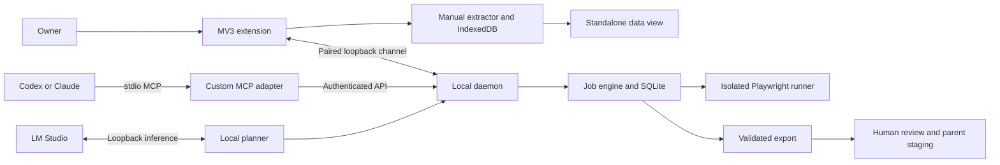

# Implementation architecture and boundary specification
Proposed detailed baseline. S1 [[System_Architecture]] is overview. No runtime created. Version selections validated in [[Dependency_and_Platform_Plan]] before installation.

## Architecture goals
- Local-first manual operation without server, model, account or cloud.
- Deterministic extraction shared across extension and runner via pure contracts/extractor packages; DOM adapters differ.
- Typed API/recipe/job contracts; source rights independent from model, UI and browser.
- Independent local daemon for durable multi-page jobs; agent process exit does not kill job.
- Single data handoff boundary to parent repository via reviewed export package.
- Modularity without unnecessary service mesh, Docker requirement or multiple database servers.

## Proposed runtime topology

There is no direct edge from model to browser, no direct edge to parent database, and no required cloud path. Optional Playwright MCP for interactive fixture development is separate from custom MCP and cannot bypass local policy.

## Module ownership
| Module | Responsibility | May depend on | Must not depend on |
|---|---|---|---|
| packages/contracts | schemas, types, version constants, errors | Zod/JSON schema | Node FS, browser globals |
| packages/source-policy | grant match, scope/limit checks | contracts | model output as authorization |
| packages/picker | pure candidate scoring/field suggestions | contracts | browser permissions, I/O |
| packages/extractor | typed record/field mapping, normalization | contracts | arbitrary eval, cloud model |
| packages/recipes | revision, validation, DAG checks | contracts, policy | UI state |
| packages/export | JSON/CSV transforms, manifest | contracts | unrestricted path |
| apps/extension/content | isolated-world DOM adapters, overlay | picker, extractor | daemon secrets, FS |
| apps/extension/background | message broker, permissions, storage | contracts, policy | page-provided privileged commands |
| apps/extension/sidepanel | view model, control flows | typed messaging | direct page DOM |
| apps/extension/data-page | dataset viewer and local export | storage adapter, export | untrusted innerHTML |
| apps/daemon/api | authenticated routes, validation | contracts, policy, jobs | arbitrary shell |
| apps/daemon/store | SQLite migrations, repositories | contracts | browser code |
| apps/daemon/jobs | queue, leases, limits, checkpoints | store, policy, runner | model-driven unbounded loops |
| packages/runner | Playwright context, DOM adapter, bounded nav | extractor, policy | browser user profile by default |
| packages/mcp | stdio tools mapped to daemon | contracts, API client | direct privileged browser/FS |
| packages/ai-provider | model calls/typed proposal parsing | contracts | grants, secrets, runner bypass |
| packages/parent-adapter | validated staging format | contracts, export | parent DB connection |
| integrations/codex,claude | supported client setup/skills | MCP tool descriptions | proprietary session tokens |

## Planned workspace and build
Root package.json with workspaces, package-lock.json, tsconfig base, lint/format configuration, documented scripts, .gitignore. apps/extension build output dist with manifest and local assets; extension package must not bundle Node modules. apps/daemon build output local executable entry (Node script), packages/mcp separate entry. Shared contracts compiled or bundled as appropriate. Use Windows-compatible paths and platform-neutral Node scripts rather than requiring Bash. Tests under fixtures/unit/integration/e2e/security. output, runtime, model caches, .env, browser profile, downloads, coverage and node_modules ignored. No production config or secrets in fixtures.
Expected commands proposed (implement exact scripts during P1): npm ci, npm run lint, npm run typecheck, npm test, npm run build, npm run test:e2e, npm run test:security. Command availability not claimed. CI fixture-only; no live website network or private account. Use checked-in lockfile and dependency review.

## Browser extension lifecycle
Manifest MV3: action, side_panel, background service_worker; activeTab, scripting, sidePanel, storage, downloads only if required by implemented export. Optional host permissions narrowly scoped to approved origins and local bridge; no blanket <all_urls>, no cookies or webRequest unless separate approved need. No remotely hosted JS; CSP self, safe render. Validate actual manifest and browser API version. Side panel opens by supported user gesture. Chrome native Side Panel is mandatory where supported. Document an actual Chrome fallback applicability decision if needed; do not force fallback or promise Brave support.
Service worker event handlers registered synchronously; store selection/dataset references in persistent stores; active state keyed by tab/document/selection generation; reconnect on suspension. Content script injection only after consent and policy; remove listeners on stop, navigation, permission revoke; messages authenticated/validated by extension context and tab identity, not page-supplied IDs. No direct content-script call to daemon; background brokers. Use one document-scoped message channel with request ID, action enum, payload schema, timeout and error.
Standalone table is extension page opened via runtime URL (tab/window), receives dataset ID, validates existence; no exposed web accessible resource that permits arbitrary data access. IndexedDB transactions handle dataset/recipe metadata, rows and versions; storage.local only small settings. Quota failures surfaced; no promise of unbounded storage.

## Process lifecycle and transport
Daemon binds 127.0.0.1 only; local port configurable (initial proposed 8765); collision prompts different approved port, no automatic public binding. Pairing requires owner-visible consent and short-lived one-time challenge; issue scoped revocable token; validate Host, Origin, method, schema and token. Extension origin bound to paired ID; MCP local client authenticates through scoped token stored outside repo; no token printed. Use HTTP request/response for commands/status; extension polls or paired channel for agent proposals. Prefer authenticated polling in P3 for simplicity, evaluate WebSocket only if latency needs justify. No unauthenticated local server discovery. Stdout MCP protocol only, diagnostics stderr with redaction. Daemon start/stop explicit; no background startup service until P8 opt-in.
Dedicated runner process/context; one active worker initially; per-job cancellation signal, graceful close, escalation only owned process. Persist job state before worker starts; acquire lease, check heartbeat; restart marks interrupted jobs paused/partial and never silently replays unauthorized scopes. Source registry and budget checked before each navigation/request and write.

## Interfaces and versioning
Contract versions independently identified: recipe schema, API, result envelope, export manifest, parent adapter. Unknown major version -> reject, no implicit migration; backward-compatible additions explicit, changes tested. API error envelope carries code/message/retryable/requestId, safe details; no stack or sensitive URL query. Stable identifiers opaque UUID-like strings generated locally, not URL secrets. Internal timestamps UTC ISO8601, UI local timezone.
Local dataset import from extension to daemon explicit user action and manifest validation; duplicate ID/version conflicts return conflict, never silently overwrite. Sync not required P1. No shared browser cookies or remote file system. Backup/restore migration tested with fixtures.
See [[Recipe_Schema_Specification]], [[Daemon_Storage_and_Job_Spec]], [[MCP_and_Agent_Integration_Spec]] for concrete contracts.

## Constraints and quality
Architecture intentionally does not choose full crawling framework or UI framework until need demonstrated; avoid dependency bloat. One logical daemon with bounded workers, not distributed service. Source rights and egress enforcement are critical; if reliable egress containment cannot be verified, remain fixture-only. Every external integration is unverified until real supported client smoke. No deployment or runtime evidence exists at planning time.

## Class C compatibility amendment — approval packet pending
This exact documentation payload is PROPOSED, not implementation or source authorization. S11 independent architecture/security review PASS applies to its reviewed design; LOW-5 protected issuance requires the affected-clause check and Owner decision. All28 added cases are NOT RUN. Approved status changes only through Owner merge of the separately authorized Class C unit.

## Generic identity, capabilities and lifecycle contract
## 1. Baseline and intended change

Accepted Architecture_Implementation_Spec, Recipe_Schema_Specification and Security_and_Source_Policy_Spec
remain authoritative. Preserve source/document/grant revision binding, explicit selection,
least privilege, strict schemas, untrusted data rendering and all182 approved verification
obligations. Current detect() is structural but current record filtering requires synthetic
data-record-id. Proposed future interfaces remove that dependency without making selectors
or durable business keys an authorization credential.

Manual operation remains local-first without daemon, cloud, AI or account. Existing current
tab gesture and owned fixture behavior are regression baselines. New support is a declared
input contract validated per source/template, not a universal website accuracy claim.

## 2. Source-agnostic group strategy

1. Owner chooses a visible scope on an authorized document. Inspect only permitted top-frame
   DOM and approved preview metadata. No full-page secret/hidden-field capture.
2. Generate bounded candidates from repeated structural relationships: tag/role, immediate
   field shapes, semantic attributes explicitly allowed as anchors, parent/child containment
   and visible geometry. Do not depend on #catalogue, .card, perfume text, p01 or data-record-id.
3. Standard tables use tbody rows with header/footer separation. Grid and Flexbox are visual
   arrangements of records, not record identity. Support repeated div/article/section/li and
   other approved record tags when they form a coherent scoped set. Preserve DOM order as the
   canonical order; CSS visual reordering is disclosed, not silently converted to identity.
4. Optional fields and inconsistent child shapes influence confidence/coverage, not invented
   data or an unreviewed wider root. Heterogeneous templates/ambiguous roots require explicit
   scope/variant selection. Do not promise arbitrary non-sibling content as one group.
5. Root-scoped CSS selectors may use bounded semantic/structural alternatives. Generated CSS
   classes and unstable HTML IDs are excluded from default durable anchors. A source-specific
   stable attribute may be opted into with validation; no arbitrary JS, XPath expansion,
   unbounded alternatives or implicit document fallback.
6. Show exact current member count, scope and ambiguity before Lock/Confirm. Verify resolved
   membership equals the reviewed ordered node set. A selector string is a locator, not proof
   that the same records still exist. Keep existing bounds until a separate measured decision.

Missing HTML IDs or generated classes do not prevent live selection: node-bound tokens below
identify actual elements. Persistent selector reproducibility still needs a unique valid
scope and identity contract; inability to find one is reported explicitly.

### 2.1 Picker membership versus extraction rows — LOW-3

R02.06 owns repeating-member identity/count/scope and a validated confirmed selection. Existing
R03.01 owns one extraction row per confirmed member and the separate field/schema/value contract.
Picker success never proves field values or coverage. A strict SelectionRef carries source/grant,
tab/document/generation, scope/session, candidate/render/confirmed revision and ordered member
tokens. It is a validated reference, not permission to extract. An explicit extraction request
adds current recipe/field schema and inspect+extract capabilities; the engine revalidates all
bindings and resolves only confirmed member roots through the authorized DOM adapter. Storage/
export remain separate gates. No global fallback, row association inference or raw DOM handles
crossing untrusted messages. Dynamic/replaced membership invalidates the handoff before use.

## 3. Two identity layers — do not conflate them

### 3.1 Live document-bound identity

Content maintains a per-document WeakMap from actual Element objects to opaque random tokens.
No token is written into page DOM/data attributes. A scope has its own opaque token and root
node reference. A live selection context contains:

`sourceId, grantRevision, tabId, documentId, documentGeneration, selectionSessionNonce,
scopeToken, candidateRevision, orderedMemberTokens, renderRevision`.

Only the trusted content/broker path issues/resolves tokens. A command must match the current
source/grant, browser tab/document, generation, scope/session and current candidate revision.
Resolve every requested token back to a member Element; recheck root, ordered membership,
visibility/eligibility and allowed operation. IDs copied across tabs/scopes/documents/revisions
are rejected even if their display labels or business keys match. Never authorize by a page-
provided ID, selector string, ordinal or sourceKey alone. Display labels may be safe tag/ordinal
labels; approved preview values require the corresponding inspection field permission.
Retain extension-panel sender validation, the panel's containing-window/current-tab binding,
per-tab serialized command queues and request/response identity matching. Recheck grant and
document context after asynchronous boundaries before publishing success; a stale completion
cannot restore a lease or confirmed view. Existing timeouts, panel heartbeat, worker recovery,
closed-overlay integrity and cancellation cleanup remain mandatory regression controls.

Tokens can fit the current bounded recordId size, but the context fields require a reviewed
versioned message-contract change. Atomically upgrade sender/broker/content validators; reject
legacy grant-less messages and unknown versions/fields. Do not default missing security fields.

### 3.2 Reproducible durable key and locator

Store a versioned identity specification in a recipe, not a live node token. Prefer, in order:

1. A unique approved semantic/business key attribute or field, with documented normalization.
2. A unique canonical approved href/key combination, within the source URL/field policy.
   Unknown/sensitive queries, userinfo and unsafe schemes are rejected, not silently stripped
   in a way that creates collisions.
3. An explicitly reviewed fingerprint of approved key fields plus structural descriptors.
   It is a candidate locator only. Generated classes and positional indexes are not stable
   keys; hashing values does not anonymize them or create read/storage permission.

Namespace a durable key by source identity and identity-spec/recipe revision. Canonical JSON
and a specified hash/normalization version can make representation reproducible, but uniqueness
must be checked on the actual reviewed scope. Preserve collision/ambiguity results; do not
append an ordinal and call an identical record stable. Saved key/locator data is untrusted
input, size-bounded and subject to the recipe/source policy.

Across reloads, resolve the saved scope/locator under a new toolbar authorization and current
grant/recipe revision. Check cardinality, approved key values and unique membership, then issue
new live tokens. The Owner reviews the new selection before any saved intent is applied.
Any required recipe identity fields need an explicitly approved schema/version migration; do not silently widen the existing strict recipe major. Imports/migrations enter draft, require validation and fresh hash/grant-bound approval, and never carry old approval forward.
No silent cross-document rebinding or selector broadening. Changed grant/recipe/identity specs
invalidate old approvals even if the logical business key remains equal.

### 3.3 Identical records and DOM replacement

- Identical records without a unique approved key are distinct only by live node identity in
  the current document. They can be excluded within that live scope, but an individual one
  cannot be reliably replayed after reload/reorder. Mark non-replayable/ambiguous and require
  fresh selection. Never promise semantic distinction not present in authorized data.
- A cloned/replaced node always gets a new live token, even if markup and key text match.
  Current Lock/Confirm and incompatible history are invalidated; explicit new review is required.
- Virtualizers may recycle the same Element for another record. Relevant text/attribute/key
  mutations advance renderRevision and invalidate the active reviewed snapshot. WeakMap node
  identity alone is insufficient to permit old actions. Keep the existing conservative
  subtree mutation stop until any more selective reconciliation is approved and tested.
- New/removed/reordered members are not silently merged into a locked set. Current count is
  mounted DOM count only; no full-dataset/pagination total is inferred.

## 4. Exclusions and Undo

Live exclusion is a set of opaque member tokens bound to the selection context. Include and
Exclude use the current revision and a resolved current member; they do not use array index,
CSS class or a synthetic data-record-id. Enforce the existing minimum-valid-selection rule.
Every accepted edit advances the monotonic candidate revision and clears Confirmed.

Undo snapshots contain context, scope/root token, ordered member tokens, selected scope,
excluded tokens and render revision, with a bounded stack (retain current30-entry bound unless
separately changed). Undo is an explicit current-context action. It may restore a prior valid
Parent/Child scope only if that snapshot's actual nodes/root remain valid in the same current
document/grant/session. Restore selection data, **not** an old document generation, permission,
grant revision or candidate revision; issue a fresh revision. Incompatible snapshots are
discarded/rejected with a clear message. Navigation, revocation, replacement and stale
membership cannot be undone into authorization or confirmation.

Persistent exclusions are opt-in recipe intent keyed by a validated durable key specification.
On a later document, resolve uniquely and show a preview, then require an explicit Apply saved
exclusions action. Missing/duplicate/changed keys stop replay; no positional fallback. Storing
source-derived key values requires storage permission, not merely permission to save local
configuration. No generic persistent exclusion replay for indistinguishable records.

## 5. Authorization layers and capabilities

| Layer/capability | What it permits | What it does not imply |
|---|---|---|
| Browser activeTab | Browser-level temporary access after the actual extension gesture | Source rights, path approval, extraction, storage or export |
| Application source approval | Current reviewed source/grant metadata and exact scope | Any individual operation unless its capability is approved and implemented |
| inspect-structure | Allowed visible structure and explicitly allowed minimal preview/key metadata | Arbitrary text/secret fields, extraction dataset, durable records, navigation |
| extract-fields | Explicit schema/field/value extraction on approved selected scope and user action | Storage/export/automated navigation |
| store-records | Permitted source-derived records/keys, approved retention and location | Export or new DOM access |
| export-records | Explicit user export of permitted data with current provenance/rights checks | Upload, remote sharing or automatic export |
| automated-navigation | A separately approved implemented bounded navigation strategy/job | Generic clicking, wildcard browsing, evasion or access outside the grant |

Proposed protected Fixture Grant v2 explicitly permits inspect/manual extraction/local dataset storage/local JSON/CSV export on the unchanged owned fixture scope. Current v1 remains inspect-only. Navigation, AI ingestion, unapproved assets/origins remain denied; ordinary Sources UI/imports cannot edit/replace/shadow either protected seed. See [[Source_Registry#Protected Fixture Grant v2 — reviewed future manual capabilities]] for reviewed transition and002.04–07 checks.

No capability silently grants another. New extraction requires current inspection and field
permissions; saving requires store-records. Export of fresh extraction requires extract/export;
export of already-stored data still revalidates current rights, provenance, allowed fields and
retention. Source-approval/configuration metadata is distinct from source-derived record data;
the latter cannot be hidden in a recipe/configuration exception.

All decisions also require implemented functionality and limits. Automated navigation remains
disabled/unimplemented in002/003; future005 and its gates still apply even if a grant schema
can represent that capability. No AI, daemon or job engine is moved into these phases.

## 6. Source Management interface and grant workflow

Propose a **Sources** page under Settings, plus a source-status card in the Side Panel:

1. **Recognize:** show the actual current origin and path from browser metadata, application
   approval state, granted/denied capabilities and missing prerequisites. If browser metadata
   is inaccessible, explain the required toolbar gesture rather than claiming the site approved.
2. **Request:** trusted extension UI creates a pending source request containing exact origin,
   path rules, allowed query/fragment policy, requested operations/fields/budgets and permission
   evidence reference. Page text, imported recipes and agents cannot self-approve it.
3. **Owner-controlled review:** source approval, capability expansion and expiry extension
   require an appropriate independently reviewed Owner authority mechanism, not a page/import/
   agent request or ordinary trusted click. Source Management may request/show pending metadata;
   it must not approve from isTrusted or a caller-supplied actor=owner label. No mechanism is
   implemented or selected in S11. If a demonstrable Owner-only authority path is unavailable,
   keep dynamic approval/activation BLOCKED; protected reviewed fixturev2 still supports the
   independently approved offline P1b workflow.
4. **Activate:** save the approved local metadata and request a fresh browser toolbar gesture
   on the approved page. Approval alone does not inject or retroactively authorize a tab.
5. **Operate:** broker checks actual URL, active tab, grant revision/capability/budget and
   document before injection and every command. Content receives a strictly validated minimal
   grant/context snapshot through the trusted extension channel and rechecks its actual URL
   and document. No page-writable global approval flag or window.postMessage authority.
6. **Change/revoke:** edits create a new revision; expiry/revocation immediately invalidate
   matching live leases, overlays, pending actions and recipe approvals. Old actions cannot
   race a revision update into access. Existing retained data is quarantined/reviewed under
   retention policy; deletion is a separate explicit Owner decision, never automatic cleanup.

Each grant records sourceId/revision/status, exact canonical origin (scheme/host/port), bounded
path rules, query/fragment allowlist, permitted actions/fields, budgets, evidence reference and
review date, purpose/retention/redistribution constraints, expiry and approval reference.
Store rights evidence references/hashes, not credentials or private document contents in Git.
Approval/import forms use strict schemas and escaped text. Imported claims of approved status
become pending; they cannot grant themselves authority. No external grant-administration API.

Path rules are exact paths or explicit segment-bounded prefixes, never origin wildcards or
substring matching. Reject ambiguous encodings, userinfo, unsafe schemes and unapproved ports;
unknown query keys/fragments are denied unless explicitly scoped. Recheck after navigation/
redirect and invalidate old document references even when the new path is also approved.
Do not reinterpret a fixture HTTP/loopback exception as a live-source exception.

Fragrantica remains blocked. Installing the extension or approving this amendment is not its
source permission. Required written authorization, reviewed scope/rights and a separately
approved grant/implementation must exist before any such source can be considered.

### 6.1 Carried source-administration ban — MEDIUM-2

Source grant approval, capability expansion and expiry extension must not be callable through
MCP tools, daemon agent APIs/tokens, AI planners, recipe imports, page messages or automated
agent workflows. Indirect browser/Computer Use UI automation is included: no privileged UI
shortcut around API denial. Agents may prepare requests/proposals only, never approve them.
Do not issue agent credentials a grant-admin scope or expose an approval action in free-form tools.

A real trusted event is not proof of human Owner identity. An agent with unrestricted same-
user OS/browser control can potentially operate a naïve Sources UI; acknowledge that threat,
do not claim a human-only guarantee from a button or profile name. The eventual Owner-controlled
authority must be outside agent-reachable authority/channels under the reviewed threat model.
Possible mechanisms need separate security design; none is chosen, installed or implemented here.
Policy text or self-declared actor labels alone do not satisfy that review.

Manual-only002/003 does not gain a daemon/MCP/AI dependency. Protected fixture grants change
only by reviewed configuration/code revisions. Non-fixture dynamic approval remains unavailable
until its appropriate Owner-controlled mechanism is reviewed; a manual pilot still needs the
separate PG-MANUAL-1 packet and explicit Owner approval. Before007 exposes any agent/browser
workflow,006.03/006.06 and007.04/007.07/007.08 must independently test actual MCP/daemon/AI/
browser/computer-use capabilities against this boundary. If isolation is not demonstrated,
block affected approval/agent exposure. AUTH-10 plus SEC-18 and AGENT-05/07 carry this constraint.
Fixturev2 AI-ingestion denial is not implicitly broadened to make agent demos pass.

### 6.2 Wall-clock expiry at every operation — LOW-4

Evaluate current wall clock against valid expiresAt/status/revision for every applicable
privileged command and operation, not merely on alarms or lease creation. Reject expired,
revoked, unknown, invalid-date, stale-document/revision or untrusted cached grants. Check after
asynchronous boundaries and immediately before effects; cached successful checks confer no authority.

| Boundary | Required fail-closed behavior |
|---|---|
| START/inspect/preview/Lock/Confirm/filter/Undo/Reselect and STATUS that exposes protected selection data | Check current grant/document and wall-clock expiry before authorized DOM/state disclosure; content event guards use bounded current context and expiry, broker reloads authoritative grant/revision |
| Sleeping worker or worker restart | On wake/request re-read status/revision/expiry; reject old lease/cache before action; do not rely on an alarm having fired |
| Expiry during active selection/content resume | On active event/check/resume invalidate unsafe selection/confirmation and clean overlay; no new DOM operation under expired authority |
| Manual extraction | Check before field reads, bounded async chunks and result publication; stop with explicit partial/error, never fabricated success |
| Local storage | Check before starting writes and immediately before commit; abort pending atomic work where possible if authority expires/revokes |
| Export | Check current export rights/provenance and clock immediately before initiating download; prevent later exports under expired grant |
| Pending responses/queue | Recheck before publishing/updating lease/view; no old completion revives authority or Confirmed |

Alarms, heartbeat and watchdog are supplementary cleanup mechanisms. A suspended process
cannot promise exact-deadline execution; on resumption no privileged work proceeds before
validation. Clock-invalid/detected clock-anomaly conditions fail closed without fetching a
remote clock or adding a backend dependency. Do not promise recall of a download or reversal
of a commit already permissibly initiated/completed; preserve exact partial/effect evidence,
stop subsequent work and follow retention review without automatic data/backup deletion.
AUTH-03 expands across all rows; AUTH-05/06/07 and PG/AUTH-09 bind the relevant boundaries.

## 7. Network and least-privilege preservation

Retain activeTab, scripting, sidePanel and storage as the default permission model. No all_urls,
blanket host grants, cookies, webRequest or unreviewed global settings. Any genuinely necessary
new permission needs its own reviewed minimum-purpose decision, not this candidate's implication.
Fixed packaged code only; no remote JS or executable recipe/identity expression.

The current Security Specification does not yet authorize the early pilot. The exact proposed
exception text in [[Security_and_Source_Policy_Spec#Control3a — scoped manual pilot exception]] defines PG-MANUAL-1;
[[Security_and_Source_Policy_Spec#2. Mandatory entry packet — all ten conditions required]] supplies all ten entry conditions and named control
owners. Prefer dedicated controlled HTTPS pages, reviewed self-contained assets/CSP and actual
browser request evidence, not reused fixture-loopback permission. The extension enforces its
own source/command/read boundary; page/server/CSP/browser controls are separately evidenced.
It cannot guarantee all host-page redirects or subresource requests are prevented. Unexpected/
unapproved requests or unknown evidence block the pilot. No hosting or site access occurs here.

Full automated/live-source security remains006. Failed early pilot means BLOCKED/NOT VERIFIED;
reduced fixture-only task acceptance requires explicit reviewed Owner scope decision, not an
automatic waiver or a cyclic dependency on006. Automated navigation remains005; no daemon/MCP/
AI dependency introduced in002/003. Agent administration remains prohibited as above.

## 8. Proposed user-facing states

Use typed authorization/deny reasons, not substring matching of error messages. The following
is a proposed UI projection/contract change for002.12; it does not modify current P1a enums.

| State | Entry/meaning | Enabled behavior and exit |
|---|---|---|
| Idle | Source inspection and actual tab lease verified; no active selection | Start available; do not show readiness before STATUS establishes it |
| Awaiting Authorization | Typed reason=checking before authoritative source/tab status; or reason=browserGesture/leasePending when required authorization is absent | Checking has no privileged actions and is not an eighth state; explain gesture/pending step; validated status can lead Idle |
| Source Not Authorized | Current source/path/capability required for inspection is pending/denied/expired/revoked | Show reason and Source Management review path; no DOM access; approval still requires fresh toolbar activation |
| Selecting | Valid current context and reviewed candidate preview | Scope/filter/reselect/cancel allowed; Confirm disabled until trusted lock |
| Locked | Current exact member snapshot is frozen | Explicit review/Confirm; any accepted edit invalidates confirmation and advances revision |
| Confirmed | Explicit current-context confirmation succeeded | Confirmation is not permission for extraction/storage/export; document/grant/member/edit change clears it |
| Runtime Error | Actual transport/timeout/injection/protocol failure or unexpected safety failure | Specific safe recovery message, no stale success or implicit reauthorization |

Exactly one checking model: **Awaiting Authorization with reason=checking**. Initial pending
STATUS renders “Checking current source and tab authorization…” and enables no privileged
operation. It does not assert that the source is approved or the tab authorized. Resolution
is Idle only after valid readiness, Source Not Authorized for policy denial/expiry/revocation,
Awaiting Authorization with a specific gesture/lease reason for normal prerequisites, or
Runtime Error for actual transport/injection/protocol failure. No eighth Checking state and
no message-substring authority. UX-01/02/03 assert these exact transitions/semantics.

Expected DOM drift clears confirmation and unsafe state with a reselection notice; denial of
a storage/export capability is action-specific and does not fabricate inspection denial or
permission success. No old response/grant/selection survives expiry or revision changes.

Historical Brave authorization-label observations remain in immutable reports. Proposed002.12 fixes shared typed readiness presentation and tests UX-02 in Chrome on Windows; no Brave-specific investigation or new deferral. A demonstrated mandatory001 defect would require separate
scoped authorization; none is established by the existing message alone.

## 9. Limits and validation contract

Independently authored holdouts must cover standard tables, Grid/Flex, repeated div/article/
section/list records, nested groups, optional/inconsistent fields, delayed DOM and missing IDs/
generated classes. Gold membership is authored before running the algorithm. Source-specific
failure/ambiguity is reported honestly; confidence High is not a probability or a universal claim.

Retain ancestor8/sibling1200/signature16/outline200 and Undo30 bounds until an approved
measured change. D02/D03 accepted P1a limits remain documented. Pagination is manual separate
document selection in002/003; no automatic aggregation. Virtualization covers mounted DOM only.
Repeated identical records, replacement, recycled nodes, inaccessible frames/shadow roots and
ambiguous durable locators are explicit limitations, not silently resolved by weaker identity.

Optional display:contents/direct-tr/merged-cell diagnostics and deferred dl/dt/dd/heading-sibling ranges are explicitly classified in the revised candidate; they are not universal support obligations. Normal parser-inserted tbody remains standard-table coverage. Frames/shadow limits stay deferred.

See the candidate's complete requirement/subtask/test/security/acceptance matrix. All new
requirements/tests/counts are proposed; no capability in this document is reported installed,
tested on a real website, independently approved or production-ready.

## LOW-5 protected pilot issuance route
## 1. Proposed issuance route and authority

In proposed002.09, allow a dedicated pilot source only through a protected, independently
reviewed configuration revision, analogous to protected Fixture v2. It is a separate exact
HTTPS source grant, never the fixture seed or a runtime Sources form. Agents may draft
pending request metadata for review; that draft cannot replace or modify an active grant.
Runtime UI/commands/imports/page messages/MCP/daemon APIs/AI planners/automated-agent and
Computer Use workflows cannot create, modify, approve, activate, expand or extend it.

Owner explicitly authorizes the exact protected revision through the reviewed release/
configuration approval process outside agent-reachable approval authority. A local author
commit, an `approved=true` claim, `isTrusted`, an imported receipt or an agent-operated button
is not that authorization. Protected configuration loading accepts only independently
reviewed, Owner-approved revisions under the actual reviewed integrity/authority boundary;
arbitrary local files/duplicate records/overlapping scopes cannot shadow them.

The configuration/release integrity and Owner-decision mechanism must itself be independently
verified before activation at the exact implementation SHA. This proposal does not select
an unreviewed signature scheme or claim file immutability against unrestricted same-user OS
control. If the effective threat model permits an agent to substitute configuration or approval,
the gate stays BLOCKED until a suitable Owner-controlled mechanism is established. General
dynamic source administration remains BLOCKED; no early daemon/MCP/AI dependency is introduced.

## 2. Exact approval packet bindings

G01/G09 jointly bind the following, with no self-referential hash embedded into its own payload:

| Binding | Required content |
|---|---|
| Implementation | Exact reviewed code commit, production build hashes and protocol/policy version; source authorization and protected-loader/invalidation behavior reviewed |
| Pilot grant | Unique grantId/sourceId, immutable revision, canonical configuration byte hash, status, validity interval and revocation/version reference |
| Rights | Ownership/written authorization evidence reference and hash; permitted actions/fields, storage/export/retention/redistribution rights and expiry |
| Scope | Exact HTTPS scheme/host/port and named paths/query policy; no inherited loopback exception, wildcard or permissive fallback |
| Controlled environment | Page/server/CSP configuration and asset hashes; exact browser/profile qualification procedure and sanitized attributable request evidence |
| Decisions | Independent affected-clause/implementation security review, independent source-rights decision and explicit Owner qualification/pilot approvals, each bound to the tuple above |
| Limits | Manual-only budgets, no automated navigation/crawling/unattended jobs, no daemon/MCP/AI, denied unapproved destinations/assets and exact stop procedure |

Store review/approval receipt references outside the hashed grant payload; the final packet
binds actual code/configuration hashes. Keep private rights documents/credentials/raw captures
outside public Git. No actual source, origin, grant record or approval value is selected in S12.

## 3. Admission, revision and fail-closed behavior

All PG-MANUAL-1 G01–G10 remain mandatory. Protected issuance solves only the missing issuance
route; it does not waive source rights, approved network evidence, explicit Owner decisions
or the full006 gate. Qualification evidence needs its own authorization as already specified.

Before every applicable privileged operation, after awaits and before DOM/state/storage/export
effects, recheck the authoritative current grant revision/configuration integrity, wall-clock
expiry/status/revocation, scope, capability/field predicates, actual tab/document/generation
and reviewed packet bindings. Browser activeTab is additionally required. Cached grant data,
worker restart or scheduled alarms alone confer no authority.

A change in code, grant revision, scope/rights, page/server/CSP/configuration or revocation
invalidates affected leases, confirmations, pending operations and pilot receipts. Repeat
affected independent review/evidence and explicit Owner approval; no automatic reactivation,
expiry extension or replay. Unknown/failed predicates keep pilot BLOCKED. Stop further work,
invalidate unsafe state and clean overlays where execution is available. Do not promise cleanup
while suspended, recall of completed exports or automatic deletion of retained data/backups.

## 4. Exact Class C integration and verification

This is an addendum to, not an in-place edit of, the independently reviewed S11 proposal:

- Security Control3a/8 and gate-evidence paragraph: protected pilot issuance with exact
  G01/G09 bindings and the authority/integrity fail-closed rule above.
- Source Registry: a proposed protected pilot-grant policy, no actual grant/origin; distinct
  from read-only Fixture v1/v2 and ordinary non-fixture pending requests.
- Architecture Sources step3/§6.1: retain blocked dynamic approval; permit only this reviewed
  protected issuance route after its own security/Owner conditions. Agents cannot administer it.
- R13.06/07/08 and R16.04,002.09/13 and003.09/11: clarify the protected packet and current checks.
- AUTH-04: protected seed/configuration cannot be edited/replaced/shadowed through the forbidden
  channels. AUTH-09: test missing/mismatched code/configuration/grant/rights/Owner bindings,
  revocation/expiry and all G conditions. AUTH-10: agent/API/import/page/UI attempts denied.

No new requirement/subtask/case ID. Totals remain75/91/210, ten major tasks,00213/00311;
all28 proposed cases NOT RUN. The future Class C reviewer verifies these affected clauses
against the completed review and actual proposed patch. That targeted review is PENDING;
do not label this author-proposed LOW-5 correction independently resolved. LOW-5 does not
reopen the seven closed findings or remove readiness for Owner amendment decision.

## S13 browser-scope amendment — pending Owner approval/merge

Google Chrome on Windows is the proposed sole mandatory native browser. Brave obligations
are proposed OUT OF SCOPE, not PASS; prior observations remain historical. This is effective
only on Class C Owner merge. All applicable source/security/lifecycle/accessibility controls
remain. Shared Chromium-compatible runtime is preserved. See [[Browser_Support_Policy]].
The Class C unit is independent of001 acceptance and must become effective first; it is not
blocked on001 acceptance/merge. Later integration into001 requires separate explicit authority,
preserved history/source/build/evidence and then remaining mandatory Chrome acceptance.
