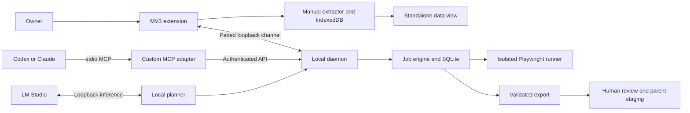

# Implementation architecture and boundary specification
Proposed detailed baseline. S1 [[System_Architecture]] is overview. No runtime created. Version selections validated in [[Dependency_and_Platform_Plan]] before installation.

## Architecture goals
- Local-first manual operation without server, model, account or cloud.
- Deterministic extraction shared across extension and runner via pure contracts/extractor packages; DOM adapters differ.
- Typed API/recipe/job contracts; source rights independent from model, UI and browser.
- Independent local daemon for durable multi-page jobs; agent process exit does not kill job.
- Single data handoff boundary to parent repository via reviewed export package.
- Modularity without unnecessary service mesh, Docker requirement or multiple database servers.

## Proposed runtime topology

There is no direct edge from model to browser, no direct edge to parent database, and no required cloud path. Optional Playwright MCP for interactive fixture development is separate from custom MCP and cannot bypass local policy.

## Module ownership
| Module | Responsibility | May depend on | Must not depend on |
|---|---|---|---|
| packages/contracts | schemas, types, version constants, errors | Zod/JSON schema | Node FS, browser globals |
| packages/source-policy | grant match, scope/limit checks | contracts | model output as authorization |
| packages/picker | pure candidate scoring/field suggestions | contracts | browser permissions, I/O |
| packages/extractor | typed record/field mapping, normalization | contracts | arbitrary eval, cloud model |
| packages/recipes | revision, validation, DAG checks | contracts, policy | UI state |
| packages/export | JSON/CSV transforms, manifest | contracts | unrestricted path |
| apps/extension/content | isolated-world DOM adapters, overlay | picker, extractor | daemon secrets, FS |
| apps/extension/background | message broker, permissions, storage | contracts, policy | page-provided privileged commands |
| apps/extension/sidepanel | view model, control flows | typed messaging | direct page DOM |
| apps/extension/data-page | dataset viewer and local export | storage adapter, export | untrusted innerHTML |
| apps/daemon/api | authenticated routes, validation | contracts, policy, jobs | arbitrary shell |
| apps/daemon/store | SQLite migrations, repositories | contracts | browser code |
| apps/daemon/jobs | queue, leases, limits, checkpoints | store, policy, runner | model-driven unbounded loops |
| packages/runner | Playwright context, DOM adapter, bounded nav | extractor, policy | browser user profile by default |
| packages/mcp | stdio tools mapped to daemon | contracts, API client | direct privileged browser/FS |
| packages/ai-provider | model calls/typed proposal parsing | contracts | grants, secrets, runner bypass |
| packages/parent-adapter | validated staging format | contracts, export | parent DB connection |
| integrations/codex,claude | supported client setup/skills | MCP tool descriptions | proprietary session tokens |

## Planned workspace and build
Root package.json with workspaces, package-lock.json, tsconfig base, lint/format configuration, documented scripts, .gitignore. apps/extension build output dist with manifest and local assets; extension package must not bundle Node modules. apps/daemon build output local executable entry (Node script), packages/mcp separate entry. Shared contracts compiled or bundled as appropriate. Use Windows-compatible paths and platform-neutral Node scripts rather than requiring Bash. Tests under fixtures/unit/integration/e2e/security. output, runtime, model caches, .env, browser profile, downloads, coverage and node_modules ignored. No production config or secrets in fixtures.
Expected commands proposed (implement exact scripts during P1): npm ci, npm run lint, npm run typecheck, npm test, npm run build, npm run test:e2e, npm run test:security. Command availability not claimed. CI fixture-only; no live website network or private account. Use checked-in lockfile and dependency review.

## Browser extension lifecycle
Manifest MV3: action, side_panel, background service_worker; activeTab, scripting, sidePanel, storage, downloads only if required by implemented export. Optional host permissions narrowly scoped to approved origins and local bridge; no blanket <all_urls>, no cookies or webRequest unless separate approved need. No remotely hosted JS; CSP self, safe render. Validate actual manifest and browser API version. Side panel opens by supported user gesture. If Brave has different side panel behavior document fallback standalone extension page and explicit manual activation; do not assert compatibility until tested.
Service worker event handlers registered synchronously; store selection/dataset references in persistent stores; active state keyed by tab/document/selection generation; reconnect on suspension. Content script injection only after consent and policy; remove listeners on stop, navigation, permission revoke; messages authenticated/validated by extension context and tab identity, not page-supplied IDs. No direct content-script call to daemon; background brokers. Use one document-scoped message channel with request ID, action enum, payload schema, timeout and error.
Standalone table is extension page opened via runtime URL (tab/window), receives dataset ID, validates existence; no exposed web accessible resource that permits arbitrary data access. IndexedDB transactions handle dataset/recipe metadata, rows and versions; storage.local only small settings. Quota failures surfaced; no promise of unbounded storage.

## Process lifecycle and transport
Daemon binds 127.0.0.1 only; local port configurable (initial proposed 8765); collision prompts different approved port, no automatic public binding. Pairing requires owner-visible consent and short-lived one-time challenge; issue scoped revocable token; validate Host, Origin, method, schema and token. Extension origin bound to paired ID; MCP local client authenticates through scoped token stored outside repo; no token printed. Use HTTP request/response for commands/status; extension polls or paired channel for agent proposals. Prefer authenticated polling in P3 for simplicity, evaluate WebSocket only if latency needs justify. No unauthenticated local server discovery. Stdout MCP protocol only, diagnostics stderr with redaction. Daemon start/stop explicit; no background startup service until P8 opt-in.
Dedicated runner process/context; one active worker initially; per-job cancellation signal, graceful close, escalation only owned process. Persist job state before worker starts; acquire lease, check heartbeat; restart marks interrupted jobs paused/partial and never silently replays unauthorized scopes. Source registry and budget checked before each navigation/request and write.

## Interfaces and versioning
Contract versions independently identified: recipe schema, API, result envelope, export manifest, parent adapter. Unknown major version -> reject, no implicit migration; backward-compatible additions explicit, changes tested. API error envelope carries code/message/retryable/requestId, safe details; no stack or sensitive URL query. Stable identifiers opaque UUID-like strings generated locally, not URL secrets. Internal timestamps UTC ISO8601, UI local timezone.
Local dataset import from extension to daemon explicit user action and manifest validation; duplicate ID/version conflicts return conflict, never silently overwrite. Sync not required P1. No shared browser cookies or remote file system. Backup/restore migration tested with fixtures.
See [[Recipe_Schema_Specification]], [[Daemon_Storage_and_Job_Spec]], [[MCP_and_Agent_Integration_Spec]] for concrete contracts.

## Constraints and quality
Architecture intentionally does not choose full crawling framework or UI framework until need demonstrated; avoid dependency bloat. One logical daemon with bounded workers, not distributed service. Source rights and egress enforcement are critical; if reliable egress containment cannot be verified, remain fixture-only. Every external integration is unverified until real supported client smoke. No deployment or runtime evidence exists at planning time.
