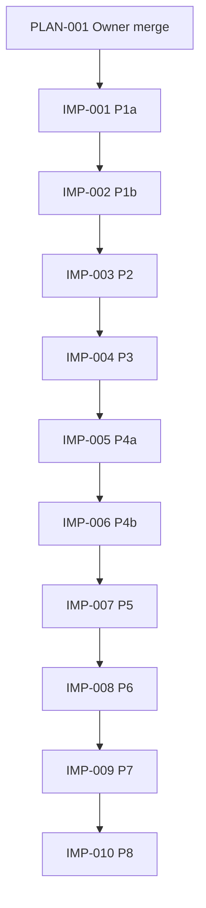

# Implementation master task map — P0 through P8
TKS-PLAN-001 / S2. Detailed review units; all proposed, not started. No runtime source before Owner merges P0. The ten implementation task IDs from S1 remain stable. Subtasks are internal checkpoints, not separate PRs by default. One task -> one branch -> one Draft PR -> one immutable acceptance receipt. If scope needs split, update task map and dependencies; material changes require planning amendment. Exact source paths below are planned, not created.

## Dependency graph

Source authorization is a separate gate; no implementation dependency can grant it. Parent writes separate parent gate. Scope may be split for review but not bypass dependencies.

## Common implementation checklist for every task
- [ ] Read AGENTS, workflow, master specification, relevant detailed docs, task note and current accepted plan.
- [ ] Verify exact merged Gate P SHA, predecessor merges, latest main/clean worktree, remote and active PRs. Route A/B/C/D.
- [ ] State TOOL DECISION, agent, exact scope, permissions, planned paths and tests; record canonical task IN PROGRESS.
- [ ] Review dependencies, versions, license/hooks and source permissions; no unauthorized setup/paid calls.
- [ ] Write focused test/fixture expectations before behavior where feasible, record RED if observed; implement minimal approved changes, GREEN and regression.
- [ ] Run lint/typecheck/build and relevant unit/integration/e2e/security; record exact commands, counts, exit and NOT RUN reasons.
- [ ] Review changed files, source rights, secret scan and diff check; no unrelated changes, no real data/credentials in Git.
- [ ] Create/update full report and separate summary, canonical task session index, status/decision/change/run log and tool usage where relevant.
- [ ] Commit/push authorized task branch, open/update Draft PR, verify remote SHA/URL/state; no force push or main write.
- [ ] Independent reviewer reads exact SHA; resolve blocker/high in scope, retest/re-review. Do not self-attest.
- [ ] Create one immutable receipt only when task acceptance ready; Owner reviews and merges. Post-merge reconcile actual state and next dependency.

## P0 — TKS-PLAN-001
Current same Draft PR #1, docs only. Review master plan, contracts, security, dependencies, test mapping and proposed decisions. Owner approval and merge required. S2 expansion is Class A, not a new implementation task. Runtime NOT RUN.

## P1a — TKS-IMP-001: Workspace, synthetic fixture server, extension shell and visual group picker

**Status:** NOT STARTED. **Recommended agent:** Codex. **Branch proposal:** feat/tks-imp-001. **Dependencies:** P0 merged; approved plan SHA verified.

**Requirements:** R01.01–04, R02.01–05, R13, R16.

**Goal:** User can load the extension in both browsers, explicitly activate an owned fixture tab and select the correct repeating group with visible outlines and cleanup. No extraction of external websites.

**Planned paths:** root workspace/build manifests; apps/extension/{manifest,background,content,sidepanel}; packages/{contracts,source-policy,picker}; tests/fixtures, unit, e2e; vault.

**Out of scope:** List field extraction/export (002), multi-section detail (003), daemon, AI, real website jobs.

### Ordered subtasks
| ID | Work item | Implementation detail | Required evidence |
|---|---|---|---|
| 001.01 | Preflight and dependency review | Verify Windows, supported Node LTS/npm, Chrome and Brave versions; inspect actual repo, approved plan, source policy; select pinned dependencies with license and hook review. | Record versions, install authorization, lockfile and smoke; no global changes. |
| 001.02 | Workspace and build skeleton | Create npm workspaces, shared TS config, scripts, ignored runtime/output/caches, local bundle pipeline and test harness. Use minimal dependencies. | Clean npm ci, lint/typecheck/build, no secrets or external runtime network. |
| 001.03 | Synthetic fixtures | Author fictional 20-card grid with sidebar distractors, table with headers, single item, nested repeated child and dynamic mutation pages. Define exact expected record IDs independently. | Fixture grant narrow and explicit; local server only; expected data checked in; no copied source HTML. |
| 001.04 | Manifest and activation | Implement MV3 action, service worker and sidepanel shell, activeTab permission model and owned fixture grant; handle unsupported pages and denied origin before injection. | Manifest review; toolbar opens panel; no all_urls or cookie permission. |
| 001.05 | Message/lifecycle broker | Typed command and response envelopes, tab/document/generation identity, worker rehydration, timeout and invalidation on navigation. | Tests for stale message, wrong tab, reload and worker restart; no invisible selection. |
| 001.06 | Overlay and hover | Isolated content script, non-layout overlay, bounded geometry, throttled hover, visible instructions, Esc/close cleanup. | Visual test scroll/resize/zoom and no host click interception outside selection. |
| 001.07 | Repeating group detection | Implement candidate ancestor analysis, structural signatures, bounded scoring, parent/child choice, confidence, scope and exact count. | Gold 20 cards selected, distractor excluded; single item does not fake group. |
| 001.08 | Selection lifecycle | Lock/reselect, include/exclude if reproducible, manual fallback, tab switch/permission revoke, listener removal. | Keyboard-only select/cancel; repeated start/stop not duplicate handlers. |
| 001.09 | Browser verification and handoff | Load unpacked Chrome and Brave Windows; collect actual versions, screenshots only of fixture, exact expected group result; document fallback if needed. | P1a acceptance before P1b; independent reviewer verifies exact SHA. |

### Task-specific acceptance
- [ ] Build/test evidence, actual Chrome + Brave smoke or explicit blocked browser acceptance, exact fixture group match, no unauthorized DOM, overlay cleanup.
- [ ] Test references: EXT-01–12, ALG-01–05, SEC-01/02/04/18/19/24. Execute applicable tests at exact reviewed SHA; mark not applicable with reason, not PASS by assumption.
- [ ] Document actual changed paths, known limitations, independent review findings and owner gate.
- [ ] Verify dependency before next task; no automatic merge, no source/production permission inferred.

## P1b — TKS-IMP-002: List extraction, fields, recipes and standalone data table

**Status:** NOT STARTED. **Recommended agent:** Codex. **Branch proposal:** feat/tks-imp-002. **Dependencies:** 001 merged.

**Requirements:** R03.01–04, R04.01–05, R06.01, R13, R16.

**Goal:** Manual single-page workflow complete without backend: select group, choose fields, preview, extract, save data, open separate table, export JSON/CSV.

**Planned paths:** apps/extension/{content,sidepanel,data-page,background}; packages/{contracts,extractor,recipes,export}; tests; vault.

**Out of scope:** Multi-page actions, nested detail workflow, daemon and external agent.

### Ordered subtasks
| ID | Work item | Implementation detail | Required evidence |
|---|---|---|---|
| 002.01 | Field candidates | Sample records, suggest relative selectors and column labels/types, calculate coverage/cardinality; allow manual selection. | Gold text/link/image-ref fields correctly scoped, optional fields handled. |
| 002.02 | Shared extraction contract | Build typed field and record validators, raw/normalized values, URL resolution and evidence statuses. | No global fallback; duplicate singleton ambiguity, required missing quarantine. |
| 002.03 | Field editor and preview | Rename field, required/type settings, preview bounded sample and actual match count, show invalid warnings. | Preview changes invalidate previous approval; no fake full row count. |
| 002.04 | Deterministic single-page run | Recheck grant/document and validated recipe before extraction, stable key, limits, atomic results and partial reason. | Compare exact expected rows on list/table fixture; no AI/network dependency. |
| 002.05 | Local dataset and recipe storage | IndexedDB versioned stores and transactions, draft recipe revision, quota/error handling, reopen data after source tab closes. | Persistence, duplicate key and restart tests; no silent overwrite. |
| 002.06 | Standalone data view | Open extension tab/window, dataset header, table/search/sort/filter, row drawer and warnings; safe text rendering. | Unicode, empty/partial/invalid data and XSS negative test. |
| 002.07 | Export and deletion | JSON canonical, CSV quoting/formula neutralization, selected/all data, local download and confirmed deletion. | Round-trip fixtures with commas, quotes, newline, Thai, malicious formula; no remote upload. |
| 002.08 | Manual installation and walkthrough | Document current P1 install/build, reproduce offline extraction in both browsers and demonstrate no backend/AI. | Owner can complete workflow from clean profile; record evidence and limitations. |

### Task-specific acceptance
- [ ] Exact gold list output, valid exports, persistent table, manual offline mode and safe rendering/permission tests.
- [ ] Test references: ALG-06–12, DATA-01–10, EXT-13–16, SEC-04/14/15/18/24. Execute applicable tests at exact reviewed SHA; mark not applicable with reason, not PASS by assumption.
- [ ] Document actual changed paths, known limitations, independent review findings and owner gate.
- [ ] Verify dependency before next task; no automatic merge, no source/production permission inferred.

## P2 — TKS-IMP-003: Multi-section detail extractor and versioned recipe builder

**Status:** NOT STARTED. **Recommended agent:** Codex, Claude Code for complex schema review. **Branch proposal:** feat/tks-imp-003. **Dependencies:** 002 merged.

**Requirements:** R05.01–05, R06.02–03, R12.01–03, R13.

**Goal:** One detail page becomes structured record with independent sections and nested arrays; no list-only restriction. Source-agnostic recipe import/export and drift checks.

**Planned paths:** packages/{contracts,extractor,recipes}; apps/extension detail UI and data-page; synthetic perfume fixtures; tests; vault.

**Out of scope:** Live source-specific recipe, source grant approval, batch navigation, model generation.

### Ordered subtasks
| ID | Work item | Implementation detail | Required evidence |
|---|---|---|---|
| 003.01 | Synthetic perfume page family | Create independently authored fictional hero, accords, rating/wear, top/middle/base notes and optional performance; variant templates with missing and ambiguous sections. | Expected gold JSON, distinct source IDs, no Fragrantica DOM or data. |
| 003.02 | Schema tree | Implement scalar/object/list kind, cardinality, scoped selector alternatives, validation depth/size and versioning. | Reject invalid type/cardinality, duplicate keys, unknown schema major. |
| 003.03 | Section picker | Allow independent root selection and nested fields; visual preview/section editor, reorder presentation. | Five sections selected independently; no cross-section association errors. |
| 003.04 | Nested extraction | Recursive scoped walker, preserve independent arrays, ordinal, missing/empty distinction and evidence. | Gold detail JSON exact; null reason, ambiguous singleton and optional fields tested. |
| 003.05 | Revision workflow | Draft/validated/approved/retired semantics, exact recipe hash, import/export, diff and validation report. | Edit creates new revision; invalid import rejected; no self-approval. |
| 003.06 | Drift and variant tests | Run against synthetic layout variations, missing section and duplicate labels; stop/flag rather than broaden selector. | Expected drift failure and manual repair path; evidence for alternatives. |
| 003.07 | Detail result table | Parent record and nested child tables/drilldown, JSON view, separate CSV relations. | No array cross-join; source relationship and ordinal preserved. |
| 003.08 | Review and manual demo | Complete fixture detail selection without AI; compare expected output and source policy. | Independent schema/UX review, report limitations and next task. |

### Task-specific acceptance
- [ ] Multiple sections and nested arrays exact, validated reusable recipe, drift fails closed, detail mode works manually without daemon.
- [ ] Test references: DETAIL-01–12, RECIPE-01–08, DATA-09/10, SEC-11/18/24. Execute applicable tests at exact reviewed SHA; mark not applicable with reason, not PASS by assumption.
- [ ] Document actual changed paths, known limitations, independent review findings and owner gate.
- [ ] Verify dependency before next task; no automatic merge, no source/production permission inferred.

## P3 — TKS-IMP-004: Authenticated local daemon, SQLite, extension pairing and custom MCP foundation

**Status:** NOT STARTED. **Recommended agent:** Claude Code design review; Codex implementation. **Branch proposal:** feat/tks-imp-004. **Dependencies:** 003 merged; version/security storage decisions verified.

**Requirements:** R01.03, R08.01–03, R09.01–02, R13.

**Goal:** Local durable service and narrow MCP tools work on owned fixtures; explicit pairing and tab lease, no unapproved jobs.

**Planned paths:** apps/daemon/{api,store,jobs,security}; packages/{mcp,contracts,source-policy}; extension broker; tests; vault.

**Out of scope:** Real multi-page runner, unattended source access, actual Codex/Claude integration and LM Studio.

### Ordered subtasks
| ID | Work item | Implementation detail | Required evidence |
|---|---|---|---|
| 004.01 | Dependency and platform spike | Verify Fastify, MCP SDK stable transport/version, SQLite driver Windows, secure credential storage and Node compatibility. | Record actual smoke; no plaintext credential storage or unsupported SDK claims. |
| 004.02 | Store and migrations | Create logical schema, foreign keys/unique indexes, transaction wrappers, migration backup/rollback, store interfaces. | Migration rollback, constraints, restart and safe storage tests. |
| 004.03 | Loopback API | Bind 127.0.0.1, readiness, request validation, error envelope, size/rate/timeout bounds, Host/Origin checks. | Port collision, invalid body, unauthorized origin/token denied. |
| 004.04 | Pairing and scopes | Owner-initiated single-use challenge, token storage/hash/expiry/revoke, client scopes. | Replay/expiry/revocation/other extension negative tests. |
| 004.05 | Tab lease and channel | Typed extension handshake, explicit consent, document generation, bounded inspect/propose via authenticated polling. | Wrong/stale tab denied; no unrelated tab access; proposal visible. |
| 004.06 | Recipe and approval API | Draft revisions, validation, owner-only approval binding hash/grant/budget; idempotent resource handling. | Agent cannot approve; grant expiry and revision mismatch denied. |
| 004.07 | Job and dataset baseline | Persistent queued/status/results structures, bounded pagination, local fixture preview and explicit extension import. | Restart and bounded output test; no real batch run until 005. |
| 004.08 | Custom MCP stdio adapter | Initialize/list tools and implement read/validate/draft/preview/status tools; unsupported run returns explicit not-available until 005. | Protocol smoke, strict args, stdout protocol only, no arbitrary FS/browser. |
| 004.09 | Integration/security checkpoint | Exercise extension ↔ daemon ↔ MCP fixture flow, token revoke, failure states and logs. | Independent review on exact SHA; document startup/stop and setup. |

### Task-specific acceptance
- [ ] Authenticated local-only service, durable records, explicit lease and narrow MCP preview, all applicable auth negatives pass.
- [ ] Test references: API-01–12, JOB-01–04, MCP-01–05, SEC-05–07/11–12/17–19/21. Execute applicable tests at exact reviewed SHA; mark not applicable with reason, not PASS by assumption.
- [ ] Document actual changed paths, known limitations, independent review findings and owner gate.
- [ ] Verify dependency before next task; no automatic merge, no source/production permission inferred.

## P4a — TKS-IMP-005: Deterministic Playwright runner and bounded multi-page job engine

**Status:** NOT STARTED. **Recommended agent:** Codex. **Branch proposal:** feat/tks-imp-005. **Dependencies:** 004 merged; fixture-only egress policy.

**Requirements:** R07.01–05, R08.03–04, R09.02, R13.

**Goal:** Execute approved recipe graph on owned fixtures with pagination/load-more/scroll/detail, limits, idempotency, cancellation and recovery.

**Planned paths:** packages/{runner,extractor,recipes,source-policy}; daemon jobs/store; MCP run/status/results/export/cancel; jobs UI; tests; vault.

**Out of scope:** Production/live crawling, source grants, stealth, unrestricted authenticated browser.

### Ordered subtasks
| ID | Work item | Implementation detail | Required evidence |
|---|---|---|---|
| 005.01 | Runner context | Install pinned Playwright/browser after review, dedicated isolated context, fixture-only allowed origins, request guard. | No shared daily browser profile or external traffic; browser cleanup. |
| 005.02 | Job admission | Validate graph, hash, grant, limits and idempotency; durable queued state, worker lease, audit. | Duplicate request returns same job; conflicting request denied. |
| 005.03 | Single page worker | Navigate approved fixture, wait bounded DOM condition, run shared extractor and atomic checkpoint. | Exact same data as manual mode; no per-row AI. |
| 005.04 | Next-page strategy | Select approved next control, handle disabled/end/repeated page and bounded wait. | Synthetic three-page output exact; cycle stops. |
| 005.05 | Load more/scroll | Bound actions and no-progress counters, unique key dedup, explicit stop reason. | Append fixture, virtualized unsupported flag, no infinite loop. |
| 005.06 | List-to-detail workflow | Validate DAG edges, fanout/depth and target scope, extract child detail with independent errors. | Gold related data, denied edge never requested, partial error recorded. |
| 005.07 | Job lifecycle | Worker lease heartbeat, cancel signal, transient retry limits, crash checkpoint and explicit resume. | No stale worker writes; no new request after cancel; restart no auto replay. |
| 005.08 | Progress and export | Status UI and MCP run/cancel/results/export, cursor bounds, partial export manifest. | Counters/terminal reason verified; no context dump or path override. |
| 005.09 | Regression and fixture demo | Multi-page test suite, clean shutdown, performance baseline, compare manual vs runner. | No live source test; exact counts and logs, independent review. |

### Task-specific acceptance
- [ ] Exact fixture list-to-detail dataset, bounded termination, crash/cancel safety, no external network.
- [ ] Test references: JOB-01–15, NAV-01–10, MCP-06–09, SEC-08–10/12/16–18/24. Execute applicable tests at exact reviewed SHA; mark not applicable with reason, not PASS by assumption.
- [ ] Document actual changed paths, known limitations, independent review findings and owner gate.
- [ ] Verify dependency before next task; no automatic merge, no source/production permission inferred.

## P4b — TKS-IMP-006: Security hardening and independent acceptance gate

**Status:** NOT STARTED. **Recommended agent:** Claude Code security analysis; Codex scoped remediation; separate read-only reviewer. **Branch proposal:** feat/tks-imp-006. **Dependencies:** 005 merged; all previous evidence available.

**Requirements:** R13.01–05, R08.04, R16.03.

**Goal:** Verify fail-closed source policy, egress, credential isolation and bounded execution before agent integration. Remain fixture-only if containment is unproven.

**Planned paths:** security policy, runner/network, extension permissions, daemon auth, export/storage, security tests, vault; only in-scope corrections.

**Out of scope:** Authorizing Fragrantica, production deployment, arbitrary security tools or broad global configuration.

### Ordered subtasks
| ID | Work item | Implementation detail | Required evidence |
|---|---|---|---|
| 006.01 | Threat-model trace | Map all SEC-01–24 to exact control/source/test; review actual package versions and data flows. | No control claimed from plan alone. |
| 006.02 | Network containment | Verify exact origin/path/request/redirect/DNS/IP checks and dedicated fixture exception; implement approved egress isolation. | Denied external/private targets not contacted; actual request evidence. |
| 006.03 | Authentication review | Review token scope/expiry/revoke, Host/Origin, challenge replay, lease identity, local binding. | All unauthorized calls rejected before side effect. |
| 006.04 | Untrusted input review | Validate malicious recipes, selectors, DOM, XSS, CSV, prompt instructions, path/symlink and oversize. | Negative controls deny; no arbitrary eval/shell. |
| 006.05 | Persistence/recovery review | Crash/replay, storage quota, safe export, redaction, retention, no parent mutation. | Atomicity and rollback evidence; secret scan. |
| 006.06 | Independent read-only review | Reviewer reads exact SHA and actual tests, classifies findings; no self-certification, no writes. | Report severity/evidence/limitations, unresolved blocker/high stops acceptance. |
| 006.07 | Targeted remediation | Fix verified issues in same scoped task/PR, rerun focused and regression, re-review. | New SHA verified, no silent scope change. |
| 006.08 | Gate outcome | Document approved fixture scope, limitations, remaining source gate, next P5. | Security acceptance not permission to scrape a source. |

### Task-specific acceptance
- [ ] Independent review and applicable negative controls, no unresolved blocker/high within scope, source gate still separate.
- [ ] Test references: SEC-01–24 applicable at P4; future AI/assets tests re-run P5–P8. Execute applicable tests at exact reviewed SHA; mark not applicable with reason, not PASS by assumption.
- [ ] Document actual changed paths, known limitations, independent review findings and owner gate.
- [ ] Verify dependency before next task; no automatic merge, no source/production permission inferred.

## P5 — TKS-IMP-007: Codex and Claude Code agent integration and visible selection workflow

**Status:** NOT STARTED. **Recommended agent:** Claude Code + Codex sequentially; independent reviewer. **Branch proposal:** feat/tks-imp-007. **Dependencies:** 006 merged; verified actual clients and owner-authorized config.

**Requirements:** R09.01–03, R10.01–03, R13.

**Goal:** Both supported clients use same custom MCP contract to inspect an owned fixture, propose selection, validate, preview and execute only approved recipe.

**Planned paths:** integrations/{codex,claude}; packages/mcp; extension proposal UI; daemon scopes; tests; vault.

**Out of scope:** Cloud MCP exposure, ChatGPT web localhost guarantee, automatic live source approval, local model.

### Ordered subtasks
| ID | Work item | Implementation detail | Required evidence |
|---|---|---|---|
| 007.01 | Client capability preflight | Inspect exact installed versions, supported MCP/skills/config mechanisms and permissions; document supported shortcut/fallback. | No invented slash command; no global install by default. |
| 007.02 | Integration docs and examples | Create repo-local config template and skill instructions per client; no secret values. | Owner explicitly authorizes registration; protocol tools enumerated. |
| 007.03 | Visible proposal UI | Show agent-selected scope/fields, generation, diff and confidence, accept/reject/edit. | Stale proposal rejected; no invisible clicking. |
| 007.04 | Approval enforcement | Owner-only run approval with grant/hash/budget; agent cannot self-approve or expand scope. | Unapproved/over-limit run denied. |
| 007.05 | Codex fixture workflow | Use real Codex client via supported prompt/skill, inspect/propose/preview/run/status/export. | Exact fixture output and invocation evidence; record unavailable if blocked. |
| 007.06 | Claude Code fixture workflow | Repeat with actual Claude Code client and its supported setup. | Same semantic output; client-specific docs verified. |
| 007.07 | Robustness and privacy | Malicious page instructions, disconnected client, revoke, bounded results, source AI-use restrictions. | No unauthorized tool action or secret transmission. |
| 007.08 | Independent review and handoff | Compare manual/agent dataset semantic equality, publish safe docs and evidence. | Both clients separately verified or acceptance pending. |

### Task-specific acceptance
- [ ] Both real clients demonstrably work on fixture with visible proposal and bounded run; no subscription token proxy.
- [ ] Test references: MCP-01–12, AGENT-01–08, SEC-03/12/15/16/18/21/24. Execute applicable tests at exact reviewed SHA; mark not applicable with reason, not PASS by assumption.
- [ ] Document actual changed paths, known limitations, independent review findings and owner gate.
- [ ] Verify dependency before next task; no automatic merge, no source/production permission inferred.

## P6 — TKS-IMP-008: LM Studio local planner, validation and model benchmark

**Status:** NOT STARTED. **Recommended agent:** Codex; Claude Code review of model trust boundary. **Branch proposal:** feat/tks-imp-008. **Dependencies:** 007 merged; actual LM Studio instance available for smoke.

**Requirements:** R11.01–04, R09, R13.

**Goal:** Local model can propose recipes and bounded tool operations through the same policy engine; offline fallback retains manual functionality.

**Planned paths:** packages/ai-provider; local planner, settings and proposal UI; mock/real integration tests; vault.

**Out of scope:** Model training, paid model API requirement, unrestricted autonomous agents or source-specific crawler.

### Ordered subtasks
| ID | Work item | Implementation detail | Required evidence |
|---|---|---|---|
| 008.01 | Provider interface | Create mockable discovery/capability/proposal/cancel interface, endpoint validation and no cloud fallback. | Unit tests, invalid endpoint rejected. |
| 008.02 | LM Studio adapter | Verify actual REST version and /models, structured output/tool calling; configurable model and budgets. | Record version/model capabilities, unsupported features explicit. |
| 008.03 | Sanitized context builder | Bounded refs/text, schema and instructions separated; filter secrets and source AI-use rights. | Prompt injection fixture and redaction tests. |
| 008.04 | Proposal validator | Strict schema/unknown keys, valid refs, allowed actions, no arbitrary code/URL; bounded repair. | Malformed/hallucinated proposal blocked, fallback after budget. |
| 008.05 | Local UI workflow | Model selection/status/cancel, visible proposal, deterministic preview and owner approval. | Offline/timeout/memory failure preserves draft; no automatic cloud. |
| 008.06 | Tool planning loop | Only same authorized daemon API, bounded iterations/output/timeout, cancel and stop on grant change. | No self-grant or direct browser call; exact fixture output. |
| 008.07 | Benchmark candidate models | Gold set, model ID/quantization/hardware/tokens/latency/mapping precision and abstention. | Measured evidence; selected model meets reviewed quality or advisory-only. |
| 008.08 | Release integration review | Mock CI + real owner-host smoke, compare manual/agent/local results, document setup/limitations. | No test claim for unavailable hardware; independent security review. |

### Task-specific acceptance
- [ ] Actual local provider smoke and fixture benchmark, invalid proposals blocked, manual fallback/no cloud.
- [ ] Test references: AI-01–12, AGENT-05–08, SEC-03/12/15/18/23/24. Execute applicable tests at exact reviewed SHA; mark not applicable with reason, not PASS by assumption.
- [ ] Document actual changed paths, known limitations, independent review findings and owner gate.
- [ ] Verify dependency before next task; no automatic merge, no source/production permission inferred.

## P7 — TKS-IMP-009: Perfume normalization, provenance and parent staging handoff

**Status:** NOT STARTED. **Recommended agent:** Claude Code for mapping review; Codex bounded implementation. **Branch proposal:** feat/tks-imp-009. **Dependencies:** 008 merged; parent read-only inspection; source rights separately assessed.

**Requirements:** R12.01–04, R14.01–03, R13.

**Goal:** Produce reproducible validated import candidate package without writing parent repository/database. Source rights not inferred from technical success.

**Planned paths:** packages/{parent-adapter,export,contracts}; validation/quarantine UI; fixture data and tests; vault.

**Out of scope:** Production import, database migration in parent, unapproved copyrighted images/reviews, live scraping without rights.

### Ordered subtasks
| ID | Work item | Implementation detail | Required evidence |
|---|---|---|---|
| 009.01 | Parent contract verification | Read latest parent main, accepted schema/ADR and data rules; map source observations to target candidates, identify missing/unknown. | Exact SHA and mapping document; no parent write. |
| 009.02 | Domain normalization | Separate brand/perfume/notes/accords/rating/wear/observations; raw vs parsed, alias mapping version. | Gold dictionary, approximate counts and unknown values preserved. |
| 009.03 | Dedup/conflict handling | Stable source keys, duplicate observations, candidate cross-source match, quarantine unresolved and orphans. | No conflation of variants or fabricated facts. |
| 009.04 | Field evidence validation | Require source/time/rule/grant/status for observed values, rights-aware raw retention. | Missing evidence fails staging; source grant mismatch denied. |
| 009.05 | Manifest/export | Generate canonical files, hashes, counts, version, status; atomic write and validated re-import. | Hash mismatch/unknown version/path traversal rejected. |
| 009.06 | Review workspace | Show mapping, counts, duplicates, quarantine, approved source, missing/conflicting values. | No automatic canonical promotion; operator can export candidate. |
| 009.07 | Dry-run parent staging | Compare against parent contract without direct DB write; report prospective create/update/reject. | Synthetic package sufficient; real import separate parent PR/Gate. |
| 009.08 | Optional source pilot gate | Only if explicit verified license/authorization and security scope permit; otherwise mark SOURCE_BLOCKED and retain fixture release. | No Fragrantica live access without written grant; no automatic third-party pilot. |

### Task-specific acceptance
- [ ] Versioned fixture package with valid hashes/relations, dry-run mapping and no parent mutation; live source remains independent.
- [ ] Test references: DOMAIN-01–12, DATA-06–10, SEC-13–15/18/20/21/24. Execute applicable tests at exact reviewed SHA; mark not applicable with reason, not PASS by assumption.
- [ ] Document actual changed paths, known limitations, independent review findings and owner gate.
- [ ] Verify dependency before next task; no automatic merge, no source/production permission inferred.

## P8 — TKS-IMP-010: Advanced optional tools, scheduling, installation and release readiness

**Status:** NOT STARTED. **Recommended agent:** Codex; independent release/security review. **Branch proposal:** feat/tks-imp-010. **Dependencies:** 009 merged; optional feature scope reviewed.

**Requirements:** R15.01–02, R16.01–03, R17 (conditional), R13.

**Goal:** Stable local release with install/upgrade/rollback, optional permissioned text/image capabilities, reliability and final review.

**Planned paths:** extension tools, daemon scheduler (opt-in), exports/assets, docs/install, tests, vault.

**Out of scope:** Cloud hosting, browser store submission, payment system, bulk contact scraping, automatic parent deployment.

### Ordered subtasks
| ID | Work item | Implementation detail | Required evidence |
|---|---|---|---|
| 010.01 | Page text extractor | Evaluate Readability or scoped DOM text, preserve metadata, rights and size limits. | Owned article fixture exact allowed text, no blanket HTML dump. |
| 010.02 | Image references/download | Refs by default; opt-in download only grant covers storage/use, MIME/size/hash checks and safe names. | Synthetic valid image and invalid/oversize denied; no external unauthorized fetch. |
| 010.03 | Other catalogue tools evaluation | Assess permitted Shopify/brand feeds, organizational social links only within approved scope; bulk personal contacts non-goal. | Decision or separate amendment; not mandatory release blocker. |
| 010.04 | Opt-in scheduler | Local-only schedule and explicit job approval/expiry/budget; daemon must be running; no surprise startup service. | Missed schedule/revoke/cancel/restart tests; no unauthorized auto replay. |
| 010.05 | Performance and reliability | Benchmark 100/1000 fictional rows, UI responsiveness, job memory/time, storage quota and long-run recovery. | Measured results with environment; tune agreed threshold, no invented performance. |
| 010.06 | Installation and upgrade | Clean Windows install, load unpacked Chrome/Brave, daemon/MCP/LM Studio optional setup, version migration and rollback. | New profile and upgrade smoke; uninstall removes only intended local artifacts. |
| 010.07 | Final end-to-end review | Manual, both agents, local AI and parent staging fixture; full regression, dependency/security and UX review. | All mandatory tests, unresolved limitations explicit, source permission separate. |
| 010.08 | Release package and handoff | Versioned local distribution instructions, changelog, support/troubleshooting, immutable receipt after acceptance. | Owner-only release/merge; no public store publication or deployment implied. |

### Task-specific acceptance
- [ ] Reproducible installation, upgrade/rollback, mandatory modes and fixture handoff verified; optional extras independently documented.
- [ ] Test references: OPS-01–12, full mandatory regression, SEC-19/22–24 and all previous applicable controls. Execute applicable tests at exact reviewed SHA; mark not applicable with reason, not PASS by assumption.
- [ ] Document actual changed paths, known limitations, independent review findings and owner gate.
- [ ] Verify dependency before next task; no automatic merge, no source/production permission inferred.

## Release sequence and stop rules
P1 usable manual list release candidate after 002; P2 detail candidate after 003; P4 deterministic automation fixture candidate after 006; P5 agent candidate after 007; P6 local AI candidate after 008; P7 handoff candidate after 009; P8 local release after 010. Each intermediate milestone can be used only within verified scope. If source or browser/client compatibility blocked, record exact limitation and keep verified modes usable; do not skip failing mandatory acceptance to claim completion. P8 optional tools can be explicitly deferred by owner without invalidating mandatory core. No fixed delivery dates or performance claims before measurements.
